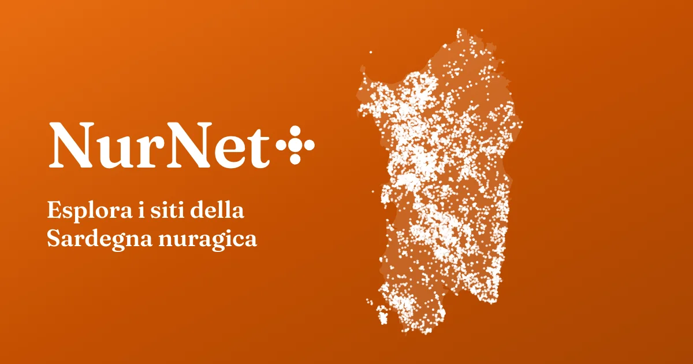
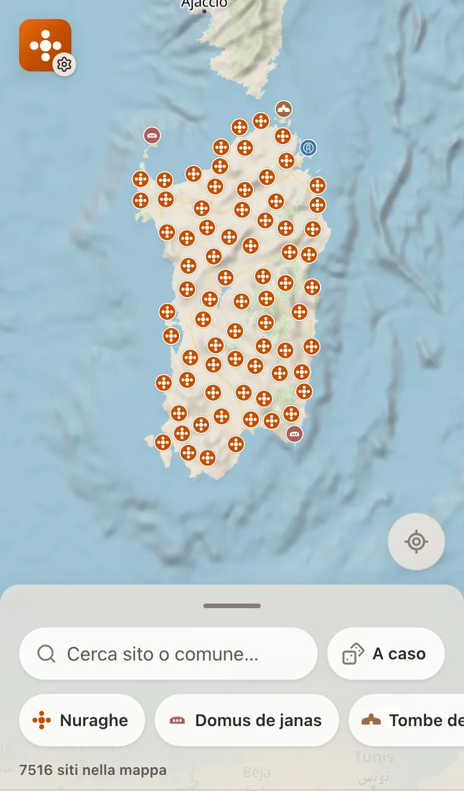
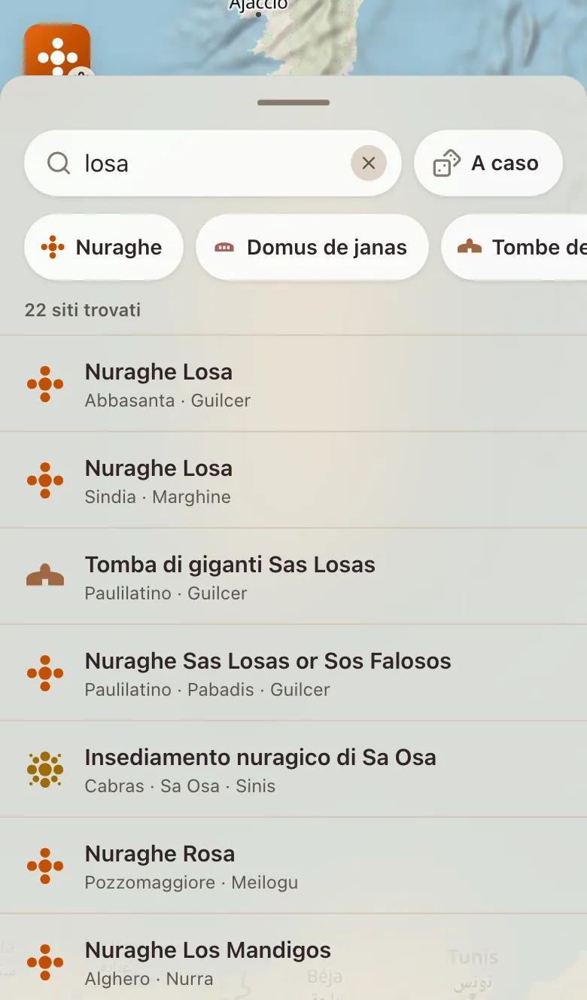
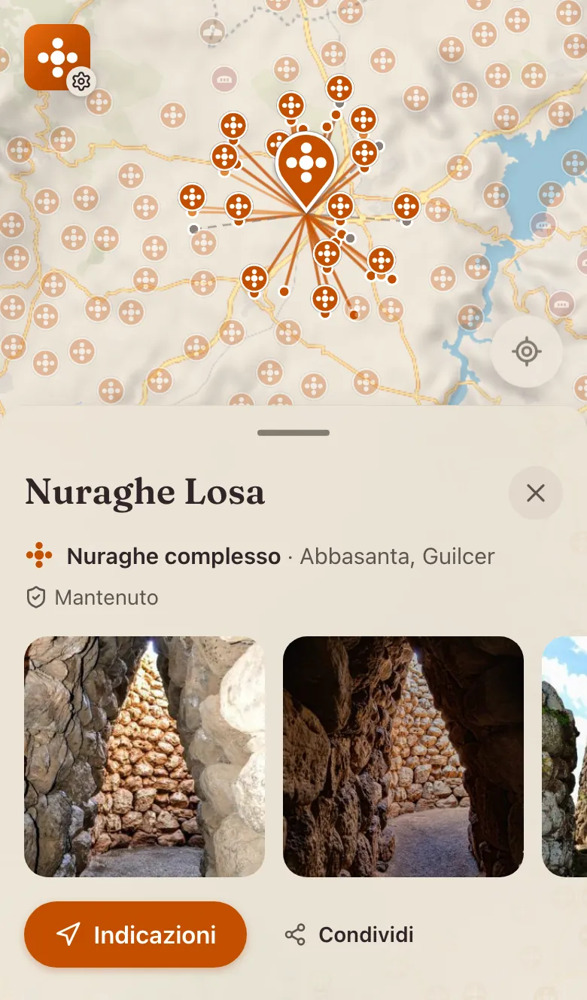

<p align="center">
  <a href="https://redemption198.github.io/nurnet-plus/">
    
  </a>
</p>

<p align="center">
  <a href="README.md">English</a> · <b>Italiano</b>
</p>

<p align="center">
  <a href="https://redemption198.github.io/nurnet-plus/"><b>Apri la mappa</b></a>
</p>

Una mappa non ufficiale dei siti della Sardegna nuragica: nuraghi, domus de janas, tombe dei giganti, pozzi sacri, villaggi, menhir, dolmen e gli altri siti censiti dal [progetto NurNet](https://www.nurnet.net/). Prende il censimento NurNet, circa 7.500 siti, e lo rende agile dal telefono, sul campo come a casa. Funziona offline e mostra sulla mappa la visibilità tra i nuraghi.

<table>
  <tr>
    <td align="center" width="33%">
      <picture>
        <source media="(prefers-color-scheme: dark)" srcset=".github/readme/map-it-dark.webp">
        
      </picture>
      <br><sub>Tutto il censimento su una mappa</sub>
    </td>
    <td align="center" width="33%">
      <picture>
        <source media="(prefers-color-scheme: dark)" srcset=".github/readme/search-it-dark.webp">
        
      </picture>
      <br><sub>Cerca per sito o comune</sub>
    </td>
    <td align="center" width="33%">
      <picture>
        <source media="(prefers-color-scheme: dark)" srcset=".github/readme/site-it-dark.webp">
        
      </picture>
      <br><sub>Un sito, la sua visibilità e le foto</sub>
    </td>
  </tr>
</table>

## Cosa fa

- **Cerca** un sito per nome o per comune: i risultati si evidenziano sulla mappa. Filtra per tipo, oppure lascia che «A caso» apra un sito qualsiasi.
- **Ogni sito** mostra tipo, luogo e stato di conservazione, con i termini del censimento, e le foto e i video della Mediateca NurNet.
- **La visibilità tra i nuraghi**, calcolata dal CRS4 sul modello digitale del terreno, tracciata da una torre all'altra.
- **2D o 3D**, con il rilievo che emerge quando la mappa si inclina.
- **Indicazioni** apre il sito nella tua app di mappe. Puoi anche condividerlo o copiarne le coordinate.
- **Offline:** un'app installabile, con i dati dei siti salvati insieme a lei e la mappa già vista conservata sul dispositivo (fino a circa 100 MB), per i posti dove il segnale non arriva.
- **Italiano e inglese.** Le descrizioni in inglese sono tradotte automaticamente; un sito la cui traduzione non ha superato i controlli mantiene il testo italiano.

## Privacy

Niente account, niente cookie, niente statistiche. La tua posizione si usa solo se tocchi «Mostra la mia posizione», e non lascia mai il dispositivo. I video si caricano solo quando li chiedi. Mappa, rilievo e foto arrivano dai servizi citati più sotto, che ricevono il tuo indirizzo IP come per qualunque pagina web.

## Crediti

NurNet+ è un'app indipendente e non ufficiale. Non è realizzata né approvata da NurNet, dalla Fondazione Nurnet o dal CRS4.

- **Dati:** dal [Geoportale NurNet](https://nurnet.crs4.it/nurnetgeo/), realizzato dal [CRS4](https://www.crs4.it/) con la [Fondazione Nurnet](https://www.nurnet.net/) e distribuito con licenza [CC BY 4.0](https://creativecommons.org/licenses/by/4.0/deed.it). Raccolti con [nurnet-dumper](https://github.com/Redemption198/nurnet-dumper), che produce anche le traduzioni inglesi delle descrizioni.
- **Foto e video:** dei rispettivi autori, pubblicati nella [Mediateca NurNet](https://www.nurnet.net/mediateca/). Sono collegati, non copiati.
- **Mappa:** [OpenFreeMap](https://openfreemap.org/), [© OpenMapTiles](https://openmaptiles.org/), dati [© OpenStreetMap contributors](https://www.openstreetmap.org/copyright), rilievo [Mapzen Terrain Tiles](https://github.com/tilezen/joerd/blob/master/docs/attribution.md) su AWS. Disegnata con [MapLibre GL JS](https://maplibre.org/).
- **Carattere:** [Fraunces](https://fonts.google.com/specimen/Fraunces), con licenza SIL Open Font License. La costa dell'immagine di copertina viene da [Natural Earth](https://www.naturalearthdata.com/), di pubblico dominio.

## Sviluppo

Un'app [Nuxt](https://nuxt.com/) con [Nuxt UI](https://ui.nuxt.com/) e MapLibre, costruita e verificata con [Vite+](https://viteplus.dev/) (`vp`) su Node 24.

```sh
vp install                  # dipendenze
vp run dev                  # server di sviluppo su http://localhost:3000
vp check                    # formattazione, lint e controllo dei tipi
vp run typecheck            # vue-tsc
vp test                     # test unitari, in test/
vp exec playwright test     # test end-to-end, in e2e/ (avvia da sé il server di sviluppo)
vp run generate             # il sito statico, sotto /nurnet-plus/, in .output/public
```

| Dove                   | Cosa                                                                                                                                                                    |
| ---------------------- | ----------------------------------------------------------------------------------------------------------------------------------------------------------------------- |
| `app/`                 | Pagine, componenti, la mappa e il worker che carica il censimento                                                                                                       |
| `i18n/locales/`        | Tutti i testi dell'interfaccia, in italiano e inglese, e i vocabolari del censimento tradotti                                                                           |
| `public/nurnet-*.json` | Il censimento: indice, dettagli, visibilità e descrizioni tradotte, come li scrive e li descrive [nurnet-dumper](https://github.com/Redemption198/nurnet-dumper#output) |
| `scripts/`             | Le icone e le schermate d'avvio dell'app (`vp run generate-pwa-assets`), l'anteprima dei link (`vp run og-image`)                                                       |
| `PRODUCT.md`           | Per chi è l'app, cosa promette e i principi che la guidano                                                                                                              |

Dopo un aggiornamento dei dati, esegui `vp run og-image` perché l'anteprima dei link disegni i nuovi siti.

## Licenza

Il codice è distribuito con [licenza MIT](LICENSE), © 2022–2026 Redemption198.

La licenza copre solo il codice. I dati del censimento restano sotto CC BY 4.0, attribuiti al CRS4 e alla Fondazione Nurnet; foto e video appartengono ai loro autori; mappa, rilievo e carattere mantengono le proprie licenze, indicate sopra.
