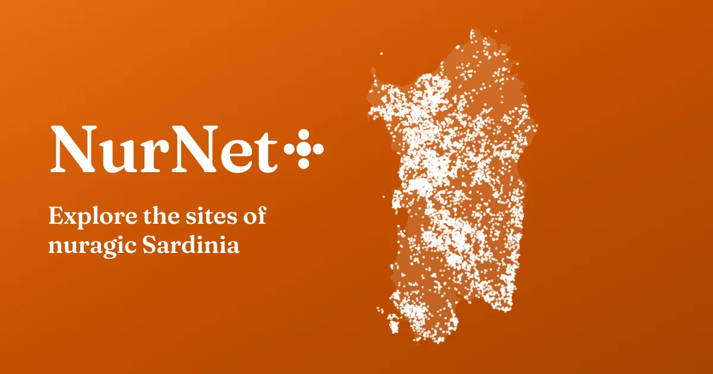
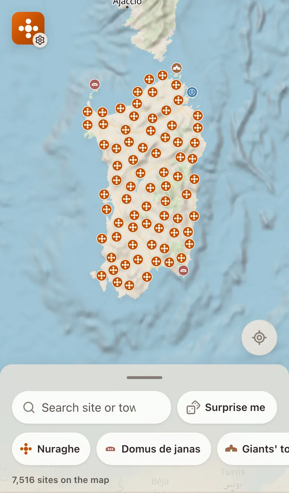
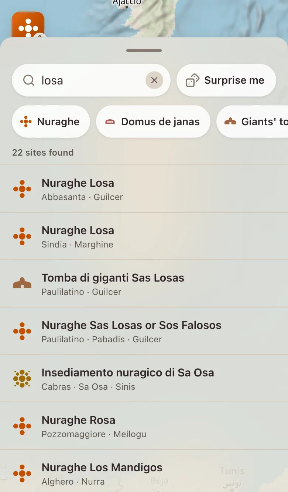
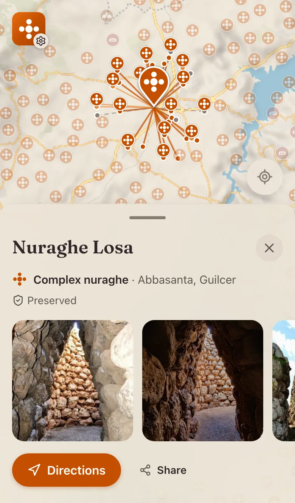

<p align="center">
  <a href="https://redemption198.github.io/nurnet-plus/en/">
    
  </a>
</p>

<p align="center">
  <b>English</b> · <a href="README.it.md">Italiano</a>
</p>

<p align="center">
  <a href="https://redemption198.github.io/nurnet-plus/en/"><b>Open the map</b></a>
</p>

An unofficial map of the sites of nuragic Sardinia: nuraghi, domus de janas, giants' tombs, sacred wells, villages, menhirs, dolmens and the others surveyed by the [NurNet project](https://www.nurnet.net/). It takes the NurNet census, about 7,500 sites, and makes it quick to use on a phone, out in the field as well as at home. It works offline, and shows the sight lines between nuraghi on the map.

<table>
  <tr>
    <td align="center" width="33%">
      <picture>
        <source media="(prefers-color-scheme: dark)" srcset=".github/readme/map-en-dark.webp">
        
      </picture>
      <br><sub>The whole census on one map</sub>
    </td>
    <td align="center" width="33%">
      <picture>
        <source media="(prefers-color-scheme: dark)" srcset=".github/readme/search-en-dark.webp">
        
      </picture>
      <br><sub>Search by site or town</sub>
    </td>
    <td align="center" width="33%">
      <picture>
        <source media="(prefers-color-scheme: dark)" srcset=".github/readme/site-en-dark.webp">
        
      </picture>
      <br><sub>A site, its sight lines and photos</sub>
    </td>
  </tr>
</table>

## What it does

- **Search** by site name or town, with the results highlighted on the map. Filter by type, or let “Surprise me” open a random site.
- **Each site** shows its type, place and state of conservation, in the census's own terms, with photos and videos from the NurNet Mediateca.
- **Sight lines** between nuraghi, computed by CRS4 on the digital terrain model, drawn from one tower to another.
- **2D or 3D**, with the terrain brought out when the map is tilted.
- **Directions** open the site in your maps app. Share it, or copy its coordinates.
- **Offline:** an installable app, with the site data saved alongside it, for the places where the signal runs out.
- **Italian and English.** The descriptions in English are machine translated, and a site whose translation failed the checks keeps its Italian text.

## Privacy

No accounts, no cookies, no analytics. Your location is used only when you tap “Show my location”, and it never leaves the device. Videos load only when you ask for them. The map, terrain and photos come from the services credited below, which receive your IP address as any web page's would.

## Credits

NurNet+ is an independent, unofficial app. It is not made or endorsed by NurNet, the Fondazione Nurnet or CRS4.

- **Data:** from the [Geoportale NurNet](https://nurnet.crs4.it/nurnetgeo/), made by [CRS4](https://www.crs4.it/) with the [Fondazione Nurnet](https://www.nurnet.net/) and released under [CC BY 4.0](https://creativecommons.org/licenses/by/4.0/). Collected with [nurnet-dumper](https://github.com/Redemption198/nurnet-dumper), which also makes the English translations of the descriptions.
- **Photos and videos:** by their respective authors, published in the [Mediateca NurNet](https://www.nurnet.net/mediateca/). They are linked, not copied.
- **Map:** [OpenFreeMap](https://openfreemap.org/), [© OpenMapTiles](https://openmaptiles.org/), data [© OpenStreetMap contributors](https://www.openstreetmap.org/copyright), terrain [Mapzen Terrain Tiles](https://github.com/tilezen/joerd/blob/master/docs/attribution.md) on AWS. Drawn with [MapLibre GL JS](https://maplibre.org/).
- **Type:** [Fraunces](https://fonts.google.com/specimen/Fraunces), under the SIL Open Font License. Coastline for the cover image from [Natural Earth](https://www.naturalearthdata.com/), public domain.

## Development

A [Nuxt](https://nuxt.com/) app with [Nuxt UI](https://ui.nuxt.com/) and MapLibre, built and checked with [Vite+](https://viteplus.dev/) (`vp`) on Node 24.

```sh
vp install                  # dependencies
vp run dev                  # dev server on http://localhost:3000
vp check                    # format, lint and type check
vp run typecheck            # vue-tsc
vp test                     # unit tests, in test/
vp exec playwright test     # end-to-end tests, in e2e/ (starts the dev server)
vp run generate             # the static site, under /nurnet-plus/, in .output/public
```

| Where                  | What                                                                                                        |
| ---------------------- | ----------------------------------------------------------------------------------------------------------- |
| `app/`                 | Pages, components, the map, and the worker that loads the census                                            |
| `i18n/locales/`        | All UI copy, Italian and English, and the census's translated vocabularies                                  |
| `public/nurnet-*.json` | The census: index, details, sight lines and translated descriptions                                         |
| `scripts/`             | The app icons and splash screens (`vp run generate-pwa-assets`), the link-preview image (`vp run og-image`) |
| `PRODUCT.md`           | Who the app is for, what it promises, and the principles behind it                                          |

After a data refresh, run `vp run og-image` so the link preview draws the new sites.

## License

The code is released under the [MIT License](LICENSE), © 2022–2026 Redemption198.

The license covers the code only. The census data stays under CC BY 4.0, credited to CRS4 and the Fondazione Nurnet; the photos and videos belong to their authors; the map, terrain and font keep their own licenses, listed above.
